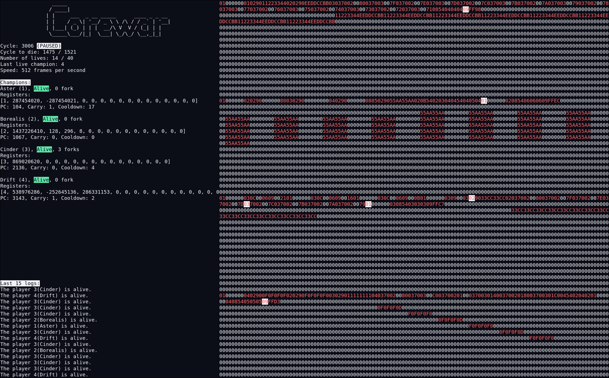
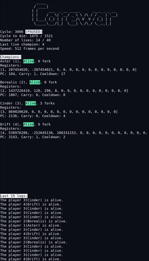
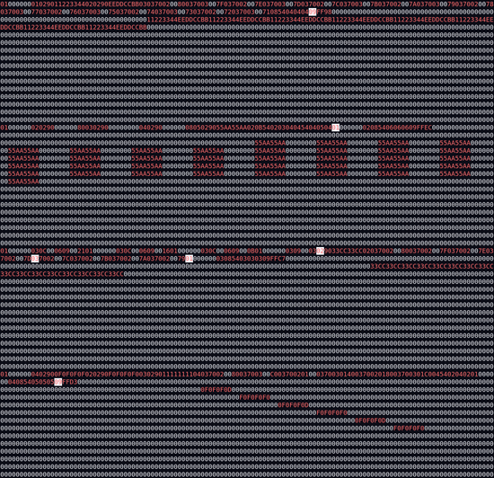
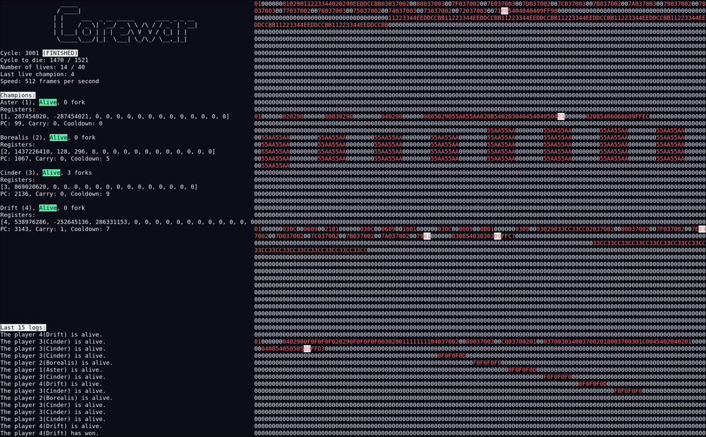

<h1 align="center">Corewar</h1>

<p align="center">
  <strong>A virtual machine for Redcode champions, with a live terminal arena.</strong>
</p>

<p align="center">
  <a href=".assets/corewar-race.png">
    
  </a>
</p>

<p align="center">
  <em>Four demo champions in the ncurses bonus: cycle control, registers, live events and the shared memory.</em>
</p>

## Screenshots

| Champion panels | Shared memory |
| :---: | :---: |
| [](.assets/corewar-champions.png) | [](.assets/corewar-memory.png) |

<a href=".assets/corewar-finished.png">
  
</a>

*A completed match; the last live champion wins.*

## How it works

Corewar loads Redcode champions into a 6 KB circular memory, schedules their
processes and reports live, death and fork events. The CLI runs the VM and prints
the trace. The ncurses bonus adds a live arena with speed and pause controls,
per-champion registers and a memory view.

## Run it

```sh
make
./corewar champions/aster.cor champions/borealis.cor
```

Build the ncurses UI, then load the four demo champions:

```sh
make -C bonus
./bonus/corewar \
  -a 0 -n 1 champions/aster.cor \
  -a 1024 -n 2 champions/borealis.cor \
  -a 2048 -n 3 champions/cinder.cor \
  -a 3072 -n 4 champions/drift.cor
```

Use the arrow keys to change speed and scroll memory, space to pause and `q` to
quit.

If GCC 15 rejects the bundled printf library or the bonus cannot find
`libcurses`, the exact flags are in [`BUILD.md`](BUILD.md).

See [`BUILD.md`](BUILD.md) for dependencies,
[`champions/README.md`](champions/README.md) for the demo champions, and
[`CREDITS.md`](CREDITS.md) for credits.

## Academic notice

EPITECH students: do not copy this code. Using it as your own work is cheating and can lead to disciplinary action.
